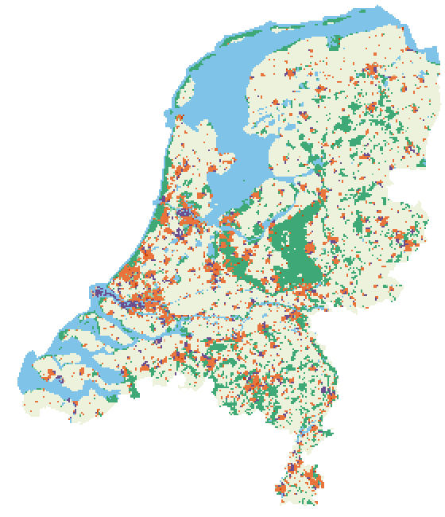

<figure class="side-figure"><figcaption>Land use in the Netherlands. Source: CBS Bestand Bodemgebruik 2022.</figcaption></figure>

SPINlab carries out research on geo-information science and spatial information management. We apply a wide range of spatial analysis methods to many scientific and societal topics. Spatial analysis aims to turn spatial data into meaningful information, which in decision making means information that helps to prepare, develop and evaluate alternatives.

The research is funded by the Dutch Research Council (NWO), Dutch science programmes such as Climate Changes Spatial Planning and Knowledge for Climate, the European Commission, Dutch ministries and other organisations. It is carried out by PhD candidates and permanent staff.

## Themes

- [Land use modelling](/research/land-use-modelling/)
- [Spatial planning](/research/spatial-planning/)
- [Climate adaptation](/research/climate-adaptation/)
- [Location value](/research/location-value/)
- [Accessibility](/research/accessibility/)
- [Geodesign and digital twins](/research/geodesign/)

Earlier projects, including our work on risk management and spatial digital humanities, are in the [research archive](/research/researcharchive/).

## From data to decisions

We work in each phase of the spatial analysis process. What we learn in the last phase feeds back into the earlier ones, so the process is iterative (Koomen, 2008).

<ol class="steps"><li>Exploratory data analysis</li><li>Explanatory data analysis</li><li>Modelling or simulation</li><li>Decision support</li><li>Evaluation or monitoring</li></ol>

## Latest updates

{{news:spatial-analysis}}
